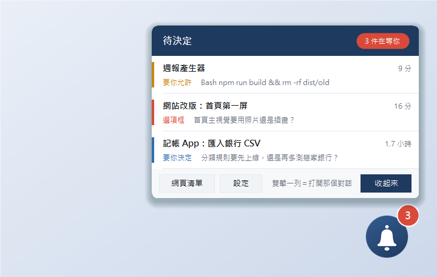
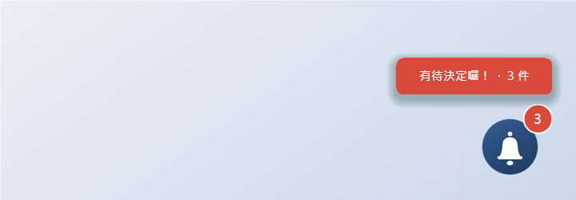
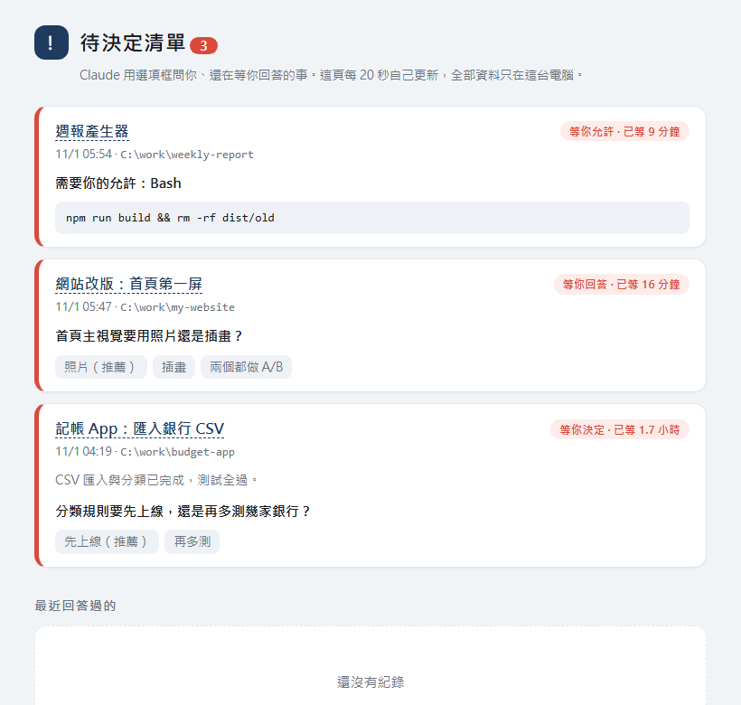

<div align="center">

# Pending Decisions Widget

**A small always-on-top icon that tells you when Claude is waiting for you.**
Run dozens of Claude Code sessions without missing the option box, permission prompt, or "ship it?" question buried in one of them.

English · [繁體中文](README.md)



</div>

---

## The problem

With many Claude Code sessions open, Claude regularly stops to ask you something — an **option box**, a **"Allow Claude to run this command?"** permission prompt — and the prompt sits in a session you aren't looking at. Claude is waiting; you think it's still working.

This tool collects everything Claude is waiting on in one place:

| Kind | What it is | Example |
|---|---|---|
| Option box | Claude asks you a question with choices (`AskUserQuestion`) | "Photo or illustration for the hero?" |
| Needs permission | "Allow Claude to run this command?" | `Bash  npm run build && rm -rf dist/old` |
| Needs a decision | The question + buttons card shown by the Claude desktop app at the end of a turn | "Ship the rules now, or test more banks?" |

- **Floating widget** — a small icon (red count badge). It shakes, beeps and pops a bubble when something new arrives; click it for the list, **double-click a row to open that session**.
- **Windows notification** the moment a question appears (click → web list).
- **Web list** — one page of cards, auto-refreshing, light/dark aware.
- Swap the icon for any picture (drag an image onto the widget); change the message text.

| Bubble + badge | Web list |
|---|---|
|  |  |

> Screenshots are the real windows rendered by the code, using demo (fake) sessions — not mock-ups. More (dark mode, settings, empty state): [docs/screenshots.md](docs/screenshots.md).

## Requirements

- **Windows 10/11** (Windows PowerShell 5.1 + WinForms; Windows toast notifications). macOS/Linux are not supported.
- **Node.js 18+** (transcript scanning and hook scripts; the installer checks).
- **Claude Code** — CLI or desktop app. With the desktop app you get session titles and click-to-open; with the CLI the title is shown as "folder (first 8 chars of session id)" and a double-click opens the web list.

## Install

```powershell
git clone https://github.com/<you>/pending-decisions-widget.git
cd pending-decisions-widget
powershell -ExecutionPolicy Bypass -File .\install.ps1 -Autostart
```

The installer copies the app to `~\.claude\pending-decisions\`, **backs up** your `settings.json`, **merges** 5 hooks into it (your existing settings and hooks are untouched; safe to re-run), and starts the widget. Restart already-open Claude sessions to load the hooks — the widget itself works without hooks for option boxes and cards (it reads the transcripts); hooks add instant toasts and permission prompts.

- `-Autostart` / `-NoAutostart` — start at login (otherwise it asks when interactive).
- `-ReplaceLegacy` — also remove an older, un-packaged `decision-log.mjs` hook to avoid double notifications.

### Uninstall

```powershell
powershell -ExecutionPolicy Bypass -File "$env:USERPROFILE\.claude\pending-decisions\install.ps1" -Uninstall
```

Removes only this tool's hooks, shortcut and program files. If `settings.json` hasn't changed since install it is **restored byte-for-byte**. Your data (`data\`) is kept unless you add `-Purge`.

## Configuration

Most things live in the widget's Settings window. Advanced options in `~\.claude\pending-decisions\config.json`:

| Key | Meaning |
|---|---|
| `toast` | `false` disables Windows notifications |
| `theme` | `auto` (follow Windows) / `light` / `dark` |
| `dataDir` | where the list, settings and icons live (default `<install>\data`) |
| `claudeDir` | Claude config folder (default `%USERPROFILE%\.claude`) |
| `sessionsDir` | Claude desktop session-metadata folder (auto-detected under `%LOCALAPPDATA%\Claude-Data`; optional) |

Env overrides: `PDW_HOME`, `PDW_DATA`, `PDW_CLAUDE_DIR`, `PDW_SESSIONS`, `PDW_THEME`.

## How it works

See [docs/how-it-works.md](docs/how-it-works.md). In short: every session's transcript (`~/.claude/projects/*/*.jsonl`) records both the question and its answer; the scanner (every 6 s) lists questions without an answer. Hooks (`PreToolUse`, `PostToolUse`, `PostToolUseFailure`, `PermissionRequest`, `Notification`) add instant toasts and permission prompts. The hook script always exits 0 and prints nothing, so it never allows/denies anything and never blocks a session.

## Privacy

Reads only your **local** transcripts to find unanswered questions. No network access, no upload, no telemetry. Session titles, question text and command summaries stay in the local `data\` folder (git-ignored).

## Troubleshooting

| Symptom | Fix |
|---|---|
| Widget doesn't appear | check `data\error.log`; make sure `node -v` works; re-run `install.ps1` |
| "Node.js not found" in the list | install Node.js LTS, restart the widget |
| "Transcript folder not found" | set `claudeDir` in `config.json` |
| No toast for permission prompts | restart Claude sessions; check `node ~\.claude\pending-decisions\bin\settings-hooks.mjs check ~\.claude\settings.json`; your Claude Code must support the `PermissionRequest` hook |
| Every toast appears twice | legacy hook still present → `install.ps1 -ReplaceLegacy` |
| Garbled Chinese | `.ps1` files must be UTF-8 **with BOM** → `node tools/ensure-bom.mjs` |

## Development

```powershell
node tests/scan-test.mjs              # smoke test with fake transcripts
powershell -File tests/install-test.ps1   # install / re-install / uninstall in a temp dir
node tools/make-demo.mjs demo         # demo environment (fake sessions)
```

`extras/claude-panel-mod/` is an **experimental** side-panel mod for the Claude desktop app (not fully verified).

## License

[MIT](LICENSE).
