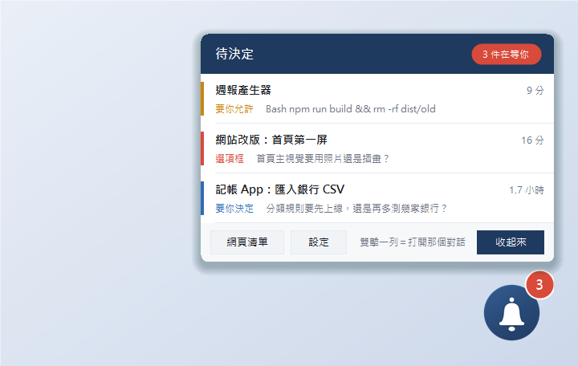
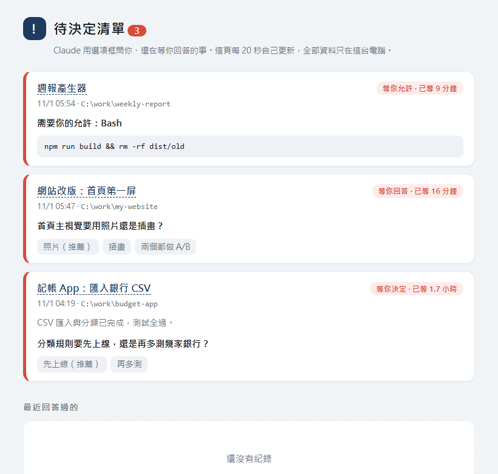

<div align="center">

# 待決定浮窗 · Pending Decisions Widget

**Claude 在等你回答的時候，桌面上有一個小圖示提醒你。**
同時開很多個 Claude Code 對話，再也不會漏看選項框、權限確認和「要不要上線」這種等你決定的問題。

[English](README.en.md) · 繁體中文



</div>

---

## 它解決什麼痛點

同時開十個、一百個 Claude Code 對話時，Claude 常常用**選項框**問你一個決定、或停下來等你**允許執行某個指令**。對話一多，那個框就藏在某個你沒在看的對話裡——Claude 在等你，你以為它還在工作，半小時就這樣過去了。

這個小工具把「Claude 在等你」集中到一個地方：

| 圖示 | 種類 | 長什麼樣子 |
|---|---|---|
| 🔴 選項框 | Claude 用選項框問你問題（`AskUserQuestion`） | 「首頁主視覺要用照片還是插畫？」 |
| 🟠 要你允許 | 「是否允許 Claude 執行此指令？」權限確認 | `Bash  npm run build && rm -rf dist/old` |
| 🔵 要你決定 | Claude 桌面版收尾時附帶的「問題＋按鈕」提問卡 | 「分類規則要先上線，還是再多測幾家銀行？」 |

- **浮窗**：螢幕角落一個小圖示（右上角有紅色數字）。有新的就抖一下、叮一聲、冒出對話框；點圖展開清單，**雙擊一列直接打開那個對話**。
- **Windows 通知**：問題一冒出來就跳一則通知，點它開網頁清單。
- **網頁清單**：一頁卡片，每 20 秒自己更新，淺色／深色模式自動切換。
- 圖示可以換成你喜歡的圖（拖一張圖到浮窗上就行），說的話也能自己改。

| 對話框與數字 | 網頁清單 |
|---|---|
|  |  |

> 截圖是用程式把真正的視窗畫成圖（資料為示範用的假對話），不是設計稿。深色模式、設定視窗、空狀態見 [docs/screenshots.md](docs/screenshots.md)。

## 前置需求

- **Windows 10／11**（浮窗用 Windows PowerShell 5.1 + WinForms，通知用 Windows Toast；目前不支援 macOS／Linux）
- **Node.js 18 以上**（掃描對話紀錄與 hook 腳本用；安裝程式會檢查）
- **Claude Code**（CLI 或桌面版皆可。桌面版會多出「點一下直接打開對話」和對話標題；CLI 版標題顯示為「資料夾名（前 8 碼）」，點擊改開網頁清單）

## 安裝

```powershell
git clone https://github.com/Pla821/pending-decisions-widget.git
cd pending-decisions-widget
powershell -ExecutionPolicy Bypass -File .\install.ps1 -Autostart
```

- `-Autostart`：開機自動啟動浮窗（不加的話，互動模式會問你；`-NoAutostart` 就不問）。
- 安裝程式會：複製程式到 `~\.claude\pending-decisions\`、**先備份**你的 `settings.json` 再把 5 個 hook **合併**進去（不動你原有的任何設定與 hook、可重複執行）、啟動浮窗。
- 已經開著的 Claude 對話要重開，才會載入新的 hook。不過**浮窗本身不靠 hook 也看得到選項框與提問卡**（它直接掃對話紀錄）；hook 負責即時的 Windows 通知與「權限確認」。
- 之前用過沒打包的舊版 `decision-log.mjs`？加 `-ReplaceLegacy` 一起換掉，避免重複通知。
- 防毒擋住 `install.ps1` 的電腦（例如公司電腦）：不要硬裝，改看 [docs/另一台電腦怎麼裝與更新.md](docs/另一台電腦怎麼裝與更新.md)（用 `start-widget.cmd`、`install-startup.cmd`，hook 手動接）。
- 想知道什麼時候會跳通知、怎麼算處理掉、哪些會誤報漏報：[docs/通知時機.md](docs/通知時機.md)。

### 移除

```powershell
powershell -ExecutionPolicy Bypass -File "$env:USERPROFILE\.claude\pending-decisions\install.ps1" -Uninstall
```

只拿掉本工具的 hook、捷徑與程式；`settings.json` 如果自安裝後沒被改過，會**原封不動還原成安裝前的樣子**。你的資料（`data\`：清單、你放的圖、設定）預設保留，不要了加 `-Purge`。

## 使用

| 操作 | 效果 |
|---|---|
| 點圖示 | 展開／收起清單 |
| 雙擊清單一列 | 打開那個對話（桌面版）；CLI 使用者開網頁清單 |
| 在任何地方按住左鍵拖 | 圖示、清單（標題／分頁／清單列／底部）、對話框、週用量小條、相機鈕、玩具箱鈕都能拖著整個浮窗走（會記住）；只點一下照舊 |
| 清單一次顯示 3 列 | 更多的用滑鼠滾輪捲（右邊的細條會告訴你捲到哪） |
| 把圖檔拖到圖示上 | 換成那張圖（照片會自動裁成置中的圓形頭像） |
| 右鍵圖示 | 設定／網頁清單／開啟資料夾／結束 |
| 設定視窗 | 換圖、改說的話、沒待決定時是否隱藏、提示音、開機自動啟動、讓圖示走來走去、養電子雞 |
| 清單上方的分頁 | **待決定**／**進行中**（現在還在跑的對話，加上對話回完了但還在跑的背景程式（下載、轉檔、腳本）；要關機前看這頁，空的＝沒有東西會被中斷）／**中斷**（疑似斷線的對話：點一下開對話並複製「請從中斷處接著做」）／**最近對話**／**專案**／**最近檔案**／**資料夾**（點一下就開） |
| 相機小圓鈕／「截圖」鈕 | 拖曳框選截圖，存到「圖片截圖」並複製到剪貼簿（只點一下＝整個畫面，Esc 取消） |
| 圖示旁的「週 84%」 | 每週用量，不用點就看得到（≥70% 黃、≥90% 紅） |
| 電子雞 | 設定裡勾「養電子雞」：餓了桌面上才出現飯糰、無聊才出現皮球，點一下就給牠；有經驗與等級（越養越大）；右鍵「電子雞」可摸摸、哄睡覺、看狀態、取名字 |
| 玩具箱 | 圖示旁的小手把鈕：一排大按鈕，丟飯糰／丟皮球／打怪獸／摸摸／睡覺（叫醒）／看狀態／換造型／設定／開關電子雞，不用右鍵；睡著時直接點小橘也能叫醒 |
| 換造型 | 右鍵「換造型」：內建 Gemini（四角星星）、ChatGPT（綠底六環）符號造型和橘色像素吉祥物（Claude 風，會跳會揮手），也列出你自己的圖；圖檔直接拖到圖示上也能換 |
| 電子雞遊戲 | 飯糰／皮球可以用滑鼠拖到桌面任何地方放開：食物會掉到地上、牠跑過去吃；皮球可以甩，牠追著踢。右鍵「電子雞」→「找怪獸打架」：點怪獸出招，怪獸變紅光時點小橘閃躲反擊，打贏拿經驗（Lv.2 起偶爾自己冒出怪獸）。右鍵「電子雞」→「關閉電子雞」整套一起停，右鍵「開啟電子雞」再開 |

### 中斷偵測
對話紀錄的最後一筆停在「正在做事」「工具剛跑完」「你剛說完話沒回」「回答寫到一半」，而且安靜超過 5 分鐘，就會列在「中斷」分頁，標出它停在哪一步。浮窗不能替你送出訊息，所以點一下只會開對話並把接續指令放進剪貼簿，由你貼上送出。

### 額度警示（選用）
`install.ps1 -UsageGuard` 會把 Claude Code 狀態列接到 `usage-feed.mjs`（已有自己的狀態列就不動）。用量 ≥90% 浮窗提醒「只做明確要的事」，≥98% 提醒「全面停止」。只有 Pro／Max 帳號的狀態列才有用量數字；沒有的話可在右鍵「回報額度 %」手動填。
**最省事（推薦）：裝 usage-feed 小模組**——Claude 桌面版／終端機版都適用，不碰登入檔、不花額度，輸入框上方會顯示「Weekly usage N%」，浮窗小條也同步即時更新。在終端機版 Claude Code 的輸入框輸入（問要不要加市集按 `y`，再選範圍）：

```
/plugin install usage-feed --marketplace Pla821/pending-decisions-widget
```

原始碼在 `extras/usage-feed-mod/`。它只會在已開著、已載入它的 Claude 對話裡更新。

沒裝模組的話，桌面版不會餵狀態列：在終端機執行一次 `claude auth login`，浮窗就會每 5 分鐘自動查一次週用量（`usage-poll.mjs`，讀本機登入檔、只連 Anthropic、不花額度；用的是非公開網址，可能失效，失效時退回「~」約略值）。登入檔的 token 約 8 小時就過期，要在終端機用一下 `claude` 才會換新；過期期間小條顯示「~」舊值。另外，有對話正在用 Fable 模型（走另一個額度池）時會提醒，已經換掉就不再顯示。

## 設定

大部分在浮窗的「設定」視窗裡改。進階選項在 `~\.claude\pending-decisions\config.json`：

```json
{
  "toast": true,
  "theme": "auto",
  "notify": { "permission": true, "question": true, "wrapup": true, "proposal": true, "fable": true, "usage": true },
  "dataDir": null,
  "claudeDir": null,
  "sessionsDir": null
}
```

| 欄位 | 說明 |
|---|---|
| `toast` | `false` 關掉 Windows 通知（只關這個；手機推播不受影響） |
| `notify` | 各種通知的開關，**預設全開**（不寫這個欄位＝全開）；只有明確寫 `false` 才關：`permission`（要你允許）、`question`（選項框）、`wrapup`（收尾提問卡）、`proposal`（建議任務卡片）、`fable`（Fable 提醒）、`usage`（額度警示）。關掉的種類不會出現在小工具與網頁清單；`permission`／`question`／`wrapup` 另外不跳 Windows 通知、不推手機。`usage` 是小工具讀的，改完要重開小工具。各種通知何時跳、何時消失見 [docs/通知時機.md](docs/通知時機.md) |
| `theme` | `auto`（跟 Windows）／`light`／`dark` |
| `ntfy` | 手機推播（選填，見下方「手機通知與核准」）：`{ "topic": "自己取一個難猜的名字" }`；另有 `server`、`detail`、`approve`、`awaySeconds`、`waitSeconds`、`onlyWhenAway` |
| `dataDir` | 清單、設定、圖放哪，預設 `<安裝資料夾>\data` |
| `claudeDir` | Claude 設定資料夾，預設 `%USERPROFILE%\.claude`（掃描 `projects\*\*.jsonl`） |
| `sessionsDir` | Claude 桌面版對話中繼檔資料夾，預設自動找 `%LOCALAPPDATA%\Claude-Data\*\claude-code-sessions`；沒有就降級 |

環境變數 `PDW_HOME`、`PDW_DATA`、`PDW_CLAUDE_DIR`、`PDW_SESSIONS`、`PDW_THEME` 可以覆蓋（測試用）。

## 運作原理（一分鐘版）

```
Claude Code 對話 ──寫入──▶ ~/.claude/projects/*/*.jsonl      （每個對話的完整紀錄）
        │                          ▲
        │ hook（即時）              │ 每 6 秒掃一次尾端：問了、還沒有回答的 = 在等你
        ▼                          │
 decision-log.mjs ──▶ data/pending.json ◀── decision-scan.mjs
        │                    │
        ▼                    ├──▶ widget.ps1  浮窗（抖動、冒泡、清單、雙擊開對話）
  Windows 通知               └──▶ pending.html  網頁清單
```

- **掃描（decision-scan）**：不靠 hook。每個對話的紀錄裡，「問了」和「回了」都有；沒配到回答的就是在等你。所以新舊對話、有沒有載入 hook 都抓得到。
- **hook（decision-log）**：選項框一問出來就即時通知；**權限確認**只有 hook 看得到（`PermissionRequest`），之後由掃描發現「這個指令已經有結果了」才算處理掉。
- 詳細說明見 [docs/how-it-works.md](docs/how-it-works.md)。

## 隱私

- **只讀你本機的對話紀錄**，只為了找出「問了還沒回答」的問題；不連網、不上傳、沒有遙測。
- 清單裡會有對話標題、問題文字和指令摘要，**全都只存在你電腦的 `data\` 資料夾**。這個資料夾已在 `.gitignore`，不會被推上 GitHub。
- hook 腳本永遠 `exit 0` 且不輸出任何東西：它**不會替你做任何允許或拒絕**，也不會擋住任何對話。
- 想看它做了什麼：整個專案不到 1,500 行，程式都在 `src\bin\`。

## 疑難排解

| 狀況 | 怎麼辦 |
|---|---|
| 浮窗沒出現 | 看 `~\.claude\pending-decisions\data\error.log`；確認 `node -v` 有輸出；重跑 `install.ps1` |
| 清單顯示「找不到 Node.js」 | 安裝 Node.js LTS（https://nodejs.org），重開浮窗 |
| 清單顯示「找不到對話紀錄資料夾」 | Claude 資料不在 `%USERPROFILE%\.claude`；在 `config.json` 設 `claudeDir` |
| 權限確認沒跳通知 | 需要已重開的 Claude 對話才載入 hook；確認 `settings.json` 的 `hooks.PermissionRequest` 有本工具那一筆（`node ~\.claude\pending-decisions\bin\settings-hooks.mjs check ~\.claude\settings.json`）；你的 Claude Code 版本需支援 `PermissionRequest` hook |
| 每個通知跳兩次 | 舊版 hook 還在：`install.ps1 -ReplaceLegacy` |
| 標題只顯示「資料夾（8碼）」 | 你用的是 CLI 版（沒有桌面版對話中繼檔），這是預期行為 |
| 中文變亂碼 | `.ps1` 檔必須是「UTF-8 with BOM」：`node tools/ensure-bom.mjs` |
| 想完全重來 | `install.ps1 -Uninstall -Purge` 再重裝 |

## 開發

```powershell
node tests/scan-test.mjs                                   # 掃描／三種待決定的冒煙測試（用假紀錄，不碰你的 ~/.claude）
node tests/notify-test.mjs                                 # notify 通知開關、建議任務卡片已處理判斷（用假紀錄）
powershell -File tests/install-test.ps1                    # 安裝／重複安裝／移除，全部在暫存資料夾
node tools/make-demo.mjs demo                              # 建示範環境（假對話），試用或拍截圖
powershell -File tools/make-icons.ps1                      # 重新產生內建圖示
```

`extras/claude-panel-mod/` 是一個**實驗性**的 Claude 桌面版側邊面板 mod（讀同一份 `pending.json`），尚未完整驗證，見該資料夾說明。

## 授權

[MIT](LICENSE)。內建圖示為本專案以向量繪製，可自由使用。

## 手機通知與核准（選填，用 ntfy）

1. 手機裝 [ntfy](https://ntfy.sh) app，訂閱你自己取的主題名稱（要又長又難猜，例如 `pdw-` 加 24 個隨機字元；知道主題名稱的人就看得到通知）。
2. 在 `config.json` 加上 `"ntfy": { "topic": "你的主題名稱" }`。之後每次有待決定，手機會收到通知。預設只送標題與件數，不含對話名稱和指令內容；加 `"detail": true` 才附內文。
3. **在手機上直接允許／拒絕**（`"approve": true`）：人不在電腦前（`awaySeconds` 預設 60 秒沒動滑鼠鍵盤）時，權限確認的通知會帶「允許」「拒絕」按鈕，並附上工具與指令內容（所以會經過 ntfy 伺服器）。最多等 `waitSeconds`（預設 100）秒，沒人按就維持原本在電腦上跳出視窗。按鈕送到另一個主題 `<topic>-r`，內含一次性碼。
   - 要同時把 settings.json 裡 PermissionRequest 這個 hook 的 timeout 調到 130 以上（重跑 install.ps1 會自動設好）。
   - ⚠️ 安全：任何知道主題名稱的人都能代你按「允許」，等於能在你的電腦上執行指令。主題名稱當密碼保管；要更安全請自架 ntfy 並開存取控制。
   - 只有「權限確認」能在手機上回答；選項框和收尾提問卡只會通知。

## 手機通知與核准（選填，用自己的飛傳伺服器「待決定信箱」）

不想經過第三方（ntfy）時，可以把待決定推到自己的[飛傳](https://github.com/Pla821/feichuan)伺服器（`pd-mailbox`，記憶體存放、不落地、不記內容）。手機開 `/pd/` 頁（可加到主畫面），按「允許／拒絕」；Android Chrome 的鎖屏推播通知上也有這兩顆鈕。

`config.json` 加（**預設關閉**，沒有 `push` 就完全不連網）：

```json
"push": { "provider": "feichuan", "server": "https://feichuan.onrender.com", "secret": "<PD_SECRET，≥32 隨機字元>",
          "approve": true, "awaySeconds": 60, "waitSeconds": 100, "onlyWhenAway": true }
```

| 欄位 | 說明 |
|---|---|
| `server` | 必須是 `https://…`（測試時可用 `http://localhost`／`127.0.0.1`）；其他 http 位址整個停用，密碼不會外送 |
| `secret` | 跟伺服器環境變數 `PD_SECRET` 一樣；少於 32 字元就停用。只放在 `Authorization` header，不寫 log、不進網址 |
| `approve` | `true` 才會等手機回答，並在通知附上工具與指令內容；`false`（預設）只推「共 N 件」標題，不含內容 |
| `onlyWhenAway` / `awaySeconds` | 預設只在人離開電腦 ≥60 秒（沿用 `idleSeconds()`）才推、才等；`false`＝不管有沒有人都推 |
| `waitSeconds` | 最多等幾秒（5～100）；每段 25 秒長輪詢，免得被代理切線 |
| `detail` | `true` 才讓純通知（非核准）也附對話名稱／內文 |

行為：沒人回、逾時、密碼錯、伺服器不通、回傳不是 `allow`／`deny`，一律**不輸出＝不放行**，電腦上照常跳出原本的允許視窗。逾時後會通知伺服器撤掉手機上的卡片。飛傳與 ntfy 同時設定時，核准走飛傳。

步驟（金鑰與 Render 環境變數的設定見飛傳 repo 的 README「待決定信箱」）：
1. 把 settings.json 裡 PermissionRequest hook 的 `timeout` 改成 ≥130（重跑 `install.ps1` 會自動設好；hook 最晚 118 秒收尾）。
2. 手機開 `https://<你的飛傳>/pd/#<PD_SECRET>` 一次完成配對（fragment 不會送到伺服器；配對後網址會被清掉），再按「開啟鎖屏通知」。
3. ⚠️ **安全**：任何拿到 `PD_SECRET` 的人都能代你按「允許」＝能在你的電腦上執行指令。請當銀行密碼保管，不要貼進對話或 repo；懷疑外洩就換掉伺服器的 `PD_SECRET` 和這裡的 `secret`。
4. iPhone：沒有通知按鈕，且必須先「分享 → 加入主畫面」才收得到推播（iOS 16.4+）；加到主畫面後是獨立儲存空間，要在頁面裡貼一次密碼。點通知開頁面再按。
5. 免費 Render 休眠／重啟會清掉信箱和推播訂閱：手機頁每次開啟會自動重新登記；建議用 UptimeRobot 之類定時 ping 讓它不休眠。

### 手機鏡像、遙控與「全部暫停／全部繼續」（選填，同樣要 `push.provider = "feichuan"`）

小工具啟動時會順便啟動常駐程式 `bin\pd-agent.mjs`（用本機埠 47831 當鎖，只會有一個）。它做三件事：

1. **鏡像**：定時把「待決定／中斷」清單上傳到你的飛傳信箱，手機開 `/pd/` 就看得到。
2. **遙控**：手機按「叫醒」「允許一次／拒絕」「收尾卡按鈕」「選項框」時，電腦端用 Windows UI 自動化在 Claude 桌面版視窗裡替你按同一個鈕（`bin\uia-click.ps1`、`bin\uia-q.ps1`）。只接受白名單動作；內容全寫死在電腦端；按之前會核對畫面上有同樣的請求，對不上就不按。
3. **全部暫停／全部繼續**：關機或拔外接硬碟前，在小工具「進行中」分頁雙擊「■ 全部暫停」（或手機 `/pd/` 的「⏸ 全部暫停」），電腦會逐個切到正在執行的對話替你按「停止」（`bin\uia-stop.ps1`；最多 20 個，等你回答選項框的對話不碰）。開機後按「▶ 全部繼續」，只叫醒剛剛停成功的那幾個。過程中 Claude 視窗會一個個切換，請先別動滑鼠鍵盤。結果記在 `data\pause.log`、`data\paused.json`。

限制：UI 自動化靠的是 Claude 桌面版畫面上的按鈕名稱（目前是「停止」「允許一次」「拒絕」…），桌面版改版後可能要跟著調整；停止鍵只在對話「執行中」才存在。
